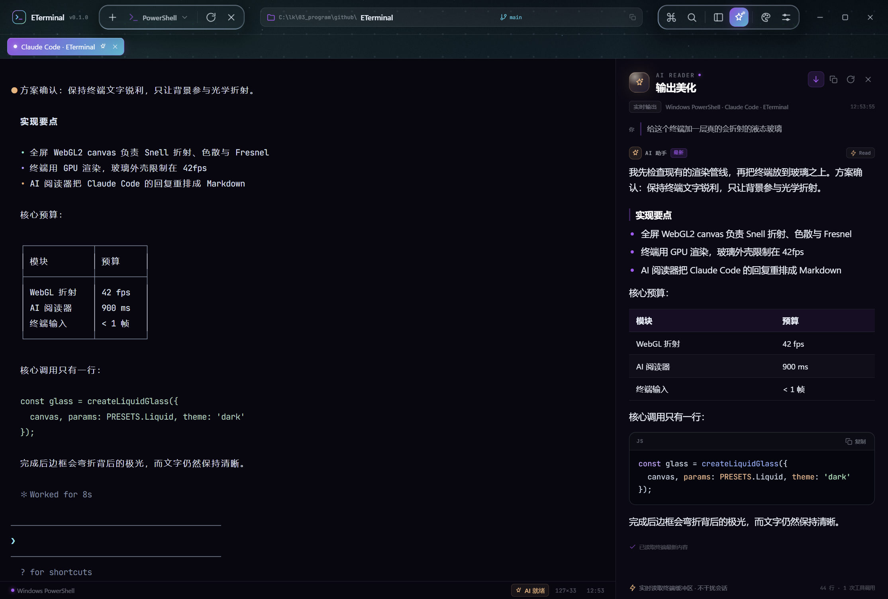
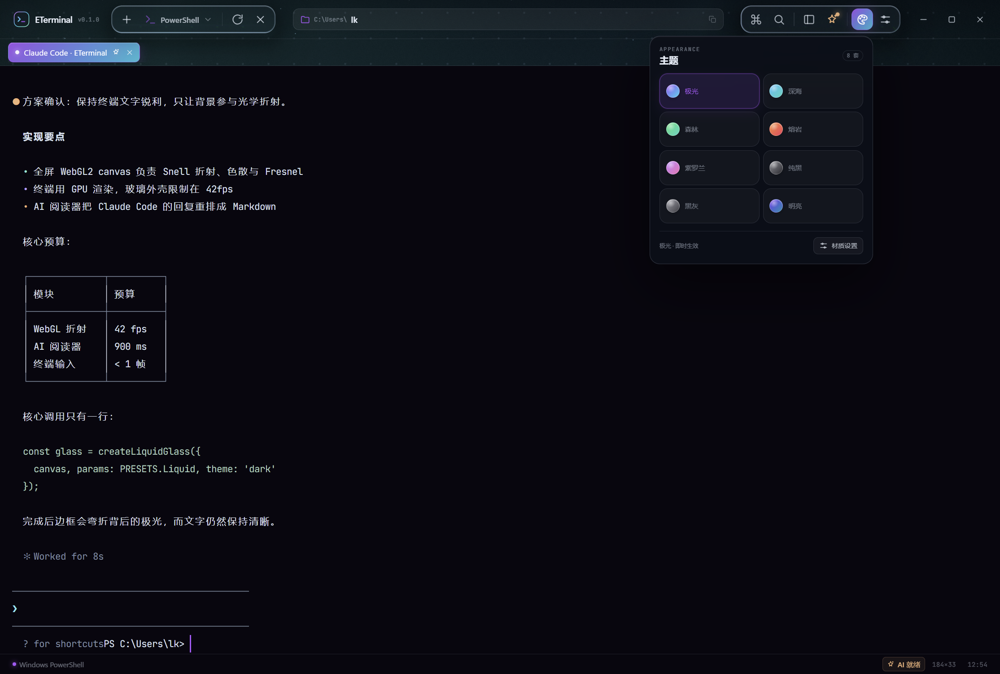
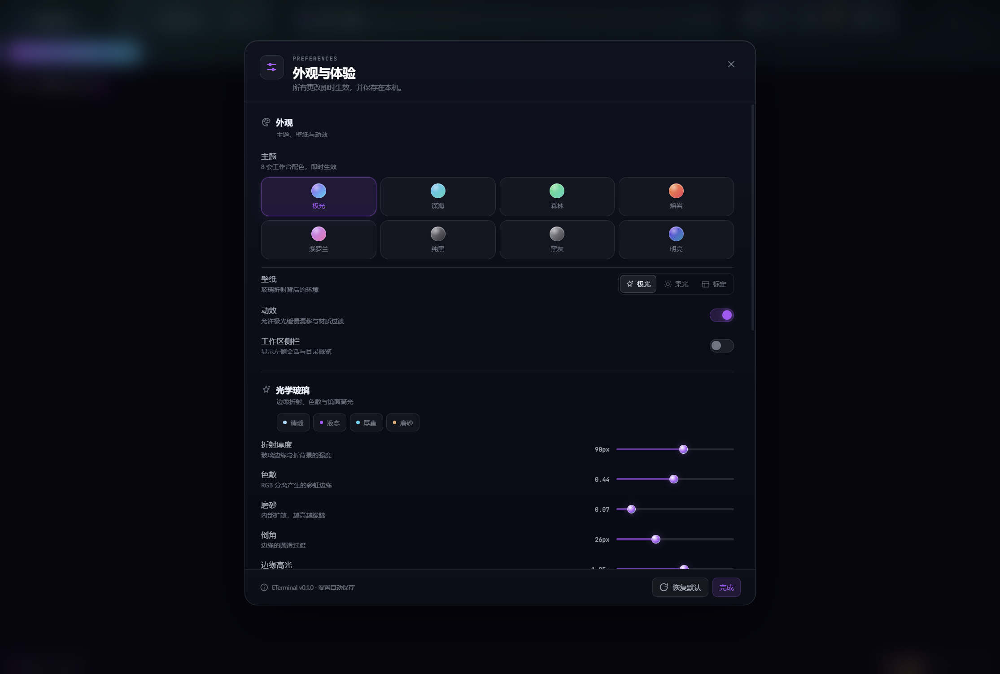
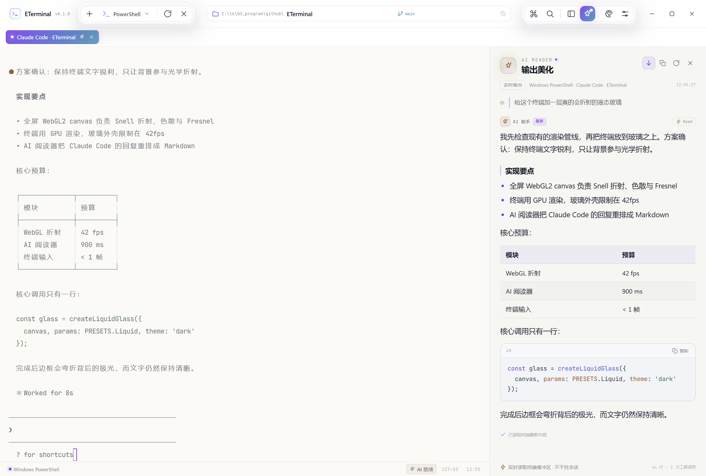
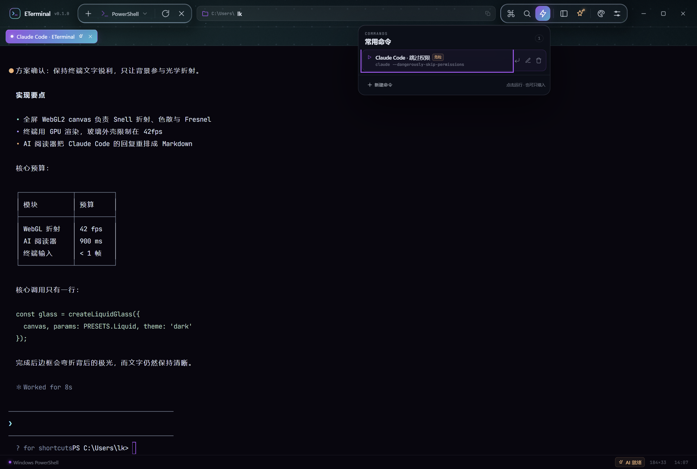

# ETerminal

一个把终端做成**桌面工作台**的 Windows 应用：58px 分组玻璃工具栏、扁平标签栏、无缝铺满工作区的终端与 AI 检查器、可收起会话侧栏，以及把 Claude Code 等 AI CLI 的回答重排成文档的 **AI 阅读器**。



## 特性

- **工作台界面**：单行 58px 工具栏、品牌与窗口控制固定两端、两组 32px 图标玻璃胶囊（会话 / 工具）、扁平的标签栏、可收起的会话侧栏（默认收起），以及右侧 AI 检查器。终端和 AI 面板直接铺满工作区，不再套外层卡片。
- **少一点框**：终端和 AI 阅读器没有外层玻璃卡、圆角或阴影；标签栏只是一条分隔带；侧栏默认收起，打开后也是平面栏；侧栏内部行、用户消息和 AI 表格使用分隔线/底色而不是嵌套卡片。玻璃只保留在工具栏的两组胶囊里。
- **常用命令**：点击工具栏闪电图标保存常用命令，支持编辑、删除、顺序随保存；点击命令直接在当前终端执行，旁边的「填入」按钮只把命令写进终端而不执行。首次启动会预置 `claude --dangerously-skip-permissions`（带危险标记，**只保存不自动执行**），可以随时删除或修改。命令保存在本机，也会出现在 `Ctrl+Shift+P` 命令面板的「常用命令」分组里。
- **无框加载**：PowerShell 启动时的加载指示器没有外框、卡片或独立背景，只是终端背景中央的一个旋转指示和文字；顶栏中央的路径胶囊在加载期间也保持可见。
- **顶栏路径胶囊**：工具栏正中间有一个约 640px 宽的路径区域，弱化显示父级路径、强调最后一级文件夹名，右侧是 Git 分支和复制按钮；鼠标悬浮显示完整路径，点击复制完整路径。路径随 PowerShell / Git Bash 的 OSC 7 实时更新，加载新会话时也不会消失。
- **真实终端，不只是网页**：使用 ConPTY + node-pty 启动 PowerShell、Git Bash、cmd 和 WSL；交互式程序、颜色、中文、鼠标、进度条都能正常工作。
- **光学液态玻璃**：一个全屏 WebGL2 canvas 在 UI 之后渲染极光环境，玻璃 shader 做 Snell 折射、RGB 色散、Fresnel 边缘与指针高光。工具栏胶囊、标签栏、侧栏、终端与 AI 面板分别使用不同厚度的玻璃表面。
- **8 套主题**：极光、深海、森林、熔岩、紫罗兰、纯黑、黑灰、明亮。点击工具栏调色盘打开主题面板，切换即时生效并自动保存；背景环境随主题色相/灰度变化，**终端底色、顶栏路径胶囊、状态栏和 AI 面板也同步为对应的暗色主题色**，光标与选区使用主题强调色。
- **高效渲染**：xterm.js WebGL 渲染器、PTY 数据直接进入 xterm 写队列、玻璃外壳限帧并限制像素预算、隐藏标签不抢占 GPU；输入和删除无额外帧延迟。
- **多标签与会话侧栏**：默认继承当前工作目录；PowerShell / Git Bash 注入 OSC 7 shell integration，状态栏和侧栏显示路径与 Git 分支；标签可重命名、中键关闭。
- **AI 阅读器**：自动检测 Claude Code 的 `⏺ / ✻` 输出，把终端缓冲区解析成用户/助手消息、工具调用和 Markdown；支持 Markdown 管道表、Unicode 框线表与 ASCII `+---+` 表，自动转成干净的数据表。代码块带语法高亮和一键复制。只读镜像，不干扰终端输入。
- **中文输入**：不仅同步 xterm 的内部锚点，还根据终端屏幕与 helper 的真实 `getBoundingClientRect` 重新计算光标单元格位置；组合输入开始时先滚到光标，再把隐藏 textarea 和预编辑层钉到光标上，避免 IME 候选框偶尔跑到远处。
- **搜索、命令面板、设置**：`Ctrl+Shift+F` 搜索当前缓冲区、`Ctrl+Shift+P` 命令面板、`Ctrl+,` 调整主题、壁纸、玻璃材质、字体、光标、侧栏与 AI 偏好。
- **安全边界**：contextIsolation + sandbox + 严格 CSP，渲染进程不直接访问 Node；Markdown 经 DOMPurify 清洗；外链只允许 http(s)/mailto。

## 截图

| 工作台 + AI 阅读器 | 8 套主题面板 |
| --- | --- |
|  |  |

| 材质与设置 | 明亮主题 |
| --- | --- |
|  |  |



## 快速开始

环境：Windows 10/11、Node.js 22.12+。首次安装需要能够下载 Electron 二进制文件。

```bash
npm install

# 开发（Vite + Electron；专用端口 5273，避免与其他 Vite 项目冲突）
npm run dev

# 生产构建并启动
npm run build
npm start

# 运行解析器单元测试
npm test
```

如果 Electron 下载失败，可以使用镜像重新安装：

PowerShell：

```powershell
$env:ELECTRON_MIRROR = "https://npmmirror.com/mirrors/electron/"
npm install
```

cmd：

```bat
set ELECTRON_MIRROR=https://npmmirror.com/mirrors/electron/
npm install
```

打包 Windows 安装包（NSIS）：

```bash
npm run dist
```

产物在 `release/`，当前已验证的安装包为 `release/ETerminal-0.1.0-x64.exe`。安装包未做代码签名，Windows SmartScreen 可能提示未知发布者；也可以直接运行 `release/win-unpacked/ETerminal.exe`。`npm run pack` 只生成未压缩的应用目录，便于本地验证。

## 快捷键

| 快捷键 | 功能 |
| --- | --- |
| `Ctrl+Shift+T` | 新建标签 |
| `Ctrl+Shift+W` | 关闭标签 |
| `Ctrl+Tab` / `Ctrl+Shift+Tab` | 切换标签 |
| `Ctrl+1…9` | 跳到第 N 个标签 |
| `Ctrl+Shift+A` | 打开 / 关闭 AI 阅读器 |
| `Ctrl+Shift+B` | 显示 / 收起工作区侧栏 |
| `Ctrl+Shift+F` | 搜索当前终端 |
| `Ctrl+Shift+P` / `F1` | 命令面板 |
| `Ctrl+,` | 设置 |
| `Ctrl+Shift+C` / `Ctrl+Shift+V` | 复制 / 粘贴 |
| `Ctrl+C` | 有选区时复制，否则发送中断 |
| `Ctrl+=` / `Ctrl+-` / `Ctrl+0` | 放大 / 缩小 / 重置字号 |
| `F11` | 全屏 |
| `Esc` | 关闭搜索或浮层 |

## AI 阅读器

Claude Code 的 Ink 界面会把回答画在终端里。ETerminal 定时读取当前标签的 xterm 缓冲区（只读），然后：

1. 去掉输入框、分隔线、状态提示和工具结果噪声；
2. 识别 `❯` 用户输入与 `⏺` 助手消息、工具调用；
3. 还原软换行、列表、标题与代码块；
4. 用 Markdown + highlight.js 呈现，并显示工具调用摘要。

打开方式：

- 检测到 Claude Code / AI 输出后，工具栏的星标图标出现琥珀色提示点，标签和状态栏出现 **AI 就绪**；
- 点击工具栏星标、侧栏的 **AI 阅读器** 卡片，或按 `Ctrl+Shift+A`；
- 也可以选中一段文本，右键选择 **美化选中内容**；
- 没有 AI 输出时，可以点 **渲染整个屏幕**，把当前缓冲区当作文档阅读。

限制：解析是启发式的；使用 alternate screen 全屏绘制的 TUI 可能读不到历史内容；数学公式与 Mermaid 不渲染；阅读器不会把内容发送到网络。

## 工作台界面

- 顶部是 58px 单行工具栏：左侧品牌，中间两组玻璃工具胶囊（会话 / 工具），右侧窗口控制。新建会话、选择 Shell、命令面板、搜索、侧栏、AI、主题和材质设置都从这里进入。
- 工具栏下方是 40px 扁平标签栏；只有标签本身有形状，活动标签使用当前主题的强调色渐变，避免再多一层整宽玻璃卡片。
- 终端从标签栏下沿直接铺到窗口底部，没有外层玻璃卡片、圆角、描边或阴影；底部状态栏使用同一底色，只留一条细分隔线。
- 左侧 188px 会话侧栏默认收起；打开后是带右侧分隔线的平面栏，包含活动会话、会话列表、当前目录、Git 分支、AI 阅读器入口和新建会话按钮。使用工具栏按钮或 `Ctrl+Shift+B` 开关。
- 右侧 AI 阅读器是平面检查器，与终端之间只是一条竖分隔线；可拖动左边缘调整宽度，终端始终是中间的工作舞台。
- 唯一保留的 WebGL 玻璃表面是工具栏的两组胶囊；其余内容区使用平面底色和细线，避免“什么都在套框”。
- 工具栏中央是宽路径胶囊：弱化父级路径 + 强调最后一级目录 + 分支；悬浮显示完整路径，点击复制；窗口变窄时优先隐藏父级和复制图标。
- AI 内容不使用嵌套卡片：用户消息是一条带强调色左边线的文本，表格使用上下细线和表头底色，代码仍保留必要的代码块。
- 主题、材质和终端偏好保存在本机，切换主题不会改变任何几何尺寸。

## Shell 支持

| Shell | 启动方式 | 工作目录同步 |
| --- | --- | --- |
| Windows PowerShell 5.1 | 内置 | 通过包装 `prompt` 发送 OSC 7 |
| PowerShell 7 | 检测 `pwsh.exe` | 同上 |
| Git Bash | 检测 Git for Windows | 通过 `--rcfile` 注入 `PROMPT_COMMAND` |
| Command Prompt | 内置 | 暂不同步 |
| WSL | 检测 `wsl.exe` | 使用 `--cd` 初始目录 |

Shell integration 只会写入 `%APPDATA%/ETerminal/shell-integration/`，不会修改你的 PowerShell 配置文件或 `.bashrc`。

## 项目结构

```
electron/
  main.cjs       窗口、IPC、PTY、shell 检测、shell integration
  preload.cjs    最小 contextBridge API
src/
  main.ts        应用编排、工具栏、侧栏、标签、快捷键、主题面板接线
  themes.ts      8 套工作台主题定义
  commands.ts    常用命令存储与预置命令
  styles.css     设计系统 + AI 阅读器/浮层样式
  workbench.css  58px 工具栏、分组胶囊、标签栏、侧栏与主题色板
  terminal/      xterm 主题与管理器（PTY 生命周期、cwd、标签）
  ai/            终端缓冲区解析器 + 安全 Markdown 渲染
  ui/            AI 阅读器、设置、主题色板、命令面板、toast、图标
  liquid-glass/  WebGL2 光学玻璃核心（含自定义 aurora 背景与限帧）
tests/           解析器单元测试
```

## 设计与性能说明

- 工作台遵循 Glass Workspace UI 的几何规范：工具栏 58px、胶囊 41px、按钮 32×32、图标 18px、组内 2px、组间 10px、窗口控制 36×28 / 14px。
- 常驻 WebGL 玻璃只保留在工具栏的两组胶囊；终端、标签栏、侧栏与 AI 面板使用平面底色/细线。文本始终位于 canvas 之上，因此保持锐利。
- 加载指示器、终端、AI 面板均不再有外层卡片；搜索框、退出提示、设置和主题面板仍是必要的临时浮层。
- 玻璃默认限制在 42fps（失焦 20fps），DPR 上限 1.75，总像素上限 360 万；可用设置面板调整材质与动态效果。
- 每个标签使用独立 xterm WebGL 上下文，最多同时保留 8 个；超出时自动退回 DOM 渲染器。
- 终端画布保持不透明（`allowTransparency: false`）。早期版本让 xterm 背景透明以透出极光，但 WebGL 在快速输入/删除时会残留旧字形；现在只让终端外框与 AI 面板参与玻璃效果，换取无残影的输入体验。
- AI 解析只在有活动标签时运行；阅读器打开时每 900ms 刷新，内容签名不变则不重建 DOM；空闲时跳过解析。
- 8 套主题通过 CSS tokens + 玻璃 canvas 的色相/灰度滤镜 + 终端表面色板实现；终端底色保持足够深以保证文字对比度，强调色体现在光标、选区、标签、分支和浮层上。
- 终端、状态栏与 AI 面板使用同一套主题表面色，切换主题不会出现色块拼接；路径胶囊使用主题强调色提示当前位置。
- 不依赖 Three.js 或 React；玻璃核心约 40KB 源码，字体只内置拉丁子集。

## 已知限制

- 主要开发和验证平台是 Windows 11；macOS/Linux 的 shell 检测尚未实现。
- cmd 与 WSL 的实时工作目录同步未接入；PowerShell 与 Git Bash 已接入。
- 自定义标题栏依赖 Electron frameless 窗口；在极少数窗口管理器下拖拽/缩放体验可能不同。
- 光学玻璃是屏幕空间近似，不是路径追踪；WebGL2 不可用时会退回 CSS 玻璃并有提示。

## 许可

MIT。内置 JetBrains Mono 的 SIL OFL 许可见 [THIRD_PARTY_NOTICES.md](THIRD_PARTY_NOTICES.md)。
